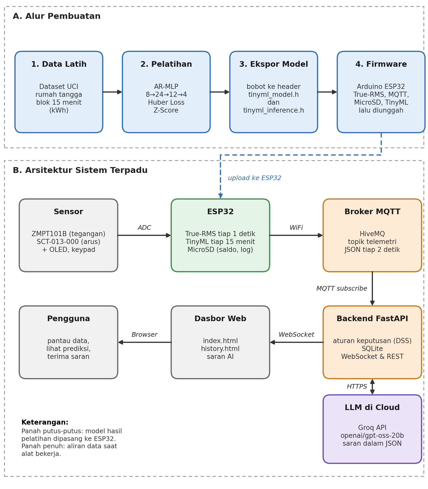

# Smart Home Power Meter & TinyML Predictor

> **Sistem Pemantauan, Prediksi, dan Rekomendasi Konsumsi Listrik Rumah Tangga 1.300 VA Berbasis AIoT dan LLM**

Proyek ini menghadirkan purwarupa alat ukur daya pintar terintegrasi (*smart energy meter*) yang dirancang khusus bagi pelanggan listrik prabayar 1.300 VA di Indonesia. Sistem menggabungkan metrologi kelistrikan berpresisi tinggi (*True-RMS*), inferensi cerdas langsung di perangkat (*On-Device TinyML*), peladen *backend* asinkron berbasis MQTT & WebSocket, serta panduan efisiensi energi bahasa alami menggunakan *Large Language Model* (LLM).

---

## Daftar Isi
- [Arsitektur Sistem](#arsitektur-sistem)
- [Fitur Utama](#fitur-utama)
- [Struktur Repositori](#struktur-repositori)
- [Spesifikasi Perangkat Keras & Pinout](#spesifikasi-perangkat-keras--pinout)
- [Modul Pelatihan TinyML](#modul-pelatihan-tinyml)
- [Panduan Instalasi & Menjalankan Sistem](#panduan-instalasi--menjalankan-sistem)
  - [1. Setup & Flashing Firmware ESP32](#1-setup--flashing-firmware-esp32)
  - [2. Menjalankan Backend FastAPI & Web Dashboard](#2-menjalankan-backend-fastapi--web-dashboard)
- [Tata Cara Pengoperasian Alat](#tata-cara-pengoperasian-alat)
- [Evaluasi & Performa Model](#evaluasi--performa-model)
- [Kredit & Pengembang](#kredit--pengembang)

---

## Arsitektur Sistem

Sistem beroperasi dalam skema terpadu tiga lapisan (*three-tier architecture*):



1. **Lapisan Tepi (*Edge IoT & TinyML*)**: Mikrokontroler ESP32 membaca sensor tegangan analog ZMPT101B dan sensor arus non-invasif SCT-013-000, menghitung parameter *True-RMS* per 1 detik, mencatat log saldo ke kartu MicroSD, dan mengeksekusi inferensi model TinyML AR-MLP secara mandiri tiap 15 menit.
2. **Lapisan Komunikasi & Backend**: Pengiriman data telemetri JSON via Wi-Fi ke broker MQTT HiveMQ tiap 2 detik. Peladen *backend* FastAPI berlangganan (*subscribe*) ke topik telemetri, menyimpan riwayat konsumsi ke basis data SQLite, menjalankan sistem pendukung keputusan (DSS) berbasis aturan proteksi, dan memanggil Groq API (`openai/gpt-oss-20b`).
3. **Lapisan Antarmuka (*Frontend Dashboard*)**: Antarmuka web reaktif (*Tailwind CSS* & *ApexCharts.js*) menyajikan data seketika melalui WebSocket, visualisasi kurva beban aktif vs semu, grafik proyeksi multi-horizon dinamis, riwayat konsumsi 15-menitan, serta kartu rekomendasi LLM.

---

## Fitur Utama

- **Metrologi True-RMS & Power Factor**: Mengukur tegangan ($V_{\text{RMS}}$), arus ($I_{\text{RMS}}$), daya aktif ($P$ Watt), daya semu ($S$ VA), dan faktor daya ($\cos\phi$) secara simultan dengan kalibrasi pergeseran fase sampling.
- **Penyimpanan Mandiri MicroSD 100%**: Saldo token, konfigurasi buffer 96 slot, dan log audit telemetri tersimpan sepenuhnya pada media penyimpanan lepas (*MicroSD Card*) dengan fitur pemulihan otomatis (*auto-recovery*) saat terjadi gangguan kartu.
- **Input Token & Reset Fisik**: Memasukkan saldo kWh baru secara langsung lewat keypad matriks 4x4 dan konfirmasi visual pada layar OLED SSD1306, dilengkapi menu proteksi kombinasi tombol reset saldo dan pembersihan kartu.
- **On-Device TinyML Multi-Horizon**: Model jaringan saraf tiruan *Autoregressive Multilayer Perceptron* (AR-MLP $8 \to 24 \to 12 \to 4$) berukuran 8,1 KB mengeksekusi prediksi konsumsi energi 24 jam ke depan ($Q_1–Q_4$) tanpa ketergantungan internet.
- **Sistem Pendukung Keputusan (DSS) & Proteksi MCB**: Aturan lokal mendeteksi beban berlebih (>85% kapasitas 1.300 VA), mitigasi risiko pemadaman fajar (pukul 21.00–05.59), dan peringatan saldo kritis (<2,0 kWh).
- **Rekomendasi Cerdas LLM (Groq API)**: Menghasilkan instruksi pengalihan jadwal pemakaian beban besar (*load shifting*) dan rekomendasi anggaran pengisian token dalam bahasa sehari-hari berformat JSON.
- **Dasbor Web Interaktif**: Dilengkapi grafik *area chart* beban real-time, grafik batang proyeksi horizon dengan rentang jam operasional riil bertingkat, serta penyaring riwayat dan ekspor CSV.

---

## Struktur Repositori

```text
.
├── Diagram_Alur_Pembuatan_dan_Arsitektur_Sistem.png  # Diagram blok alur dan arsitektur terpadu
├── skematik.png                                      # Skematik perkabelan rangkaian Fritzing
├── README.md                                         # Dokumentasi teknis utama repositori
│
├── pelatihan/                                        # Pipeline pelatihan model machine learning
│   ├── pre-training.ipynb                            # Jupyter Notebook pelatihan TinyML AR-MLP
│   ├── tinyml_energy_features.csv                   # Dataset fitur hasil prapemrosesan kontinu
│   ├── feature_mean.npy / feature_std.npy            # Parameter Z-Score normalisasi fitur
│   ├── target_mean.npy / target_std.npy              # Parameter Z-Score denormalisasi target
│   ├── pretrained_energy_model.keras                 # Bobot model terlatih format Keras
│   ├── pretrained_weights.weights.h5                 # Checkpoint bobot optimal pelatihan
│   └── tinyml_model.h                                # Parameter model diekspor ke header C++
│
├── power-meter/                                      # Kode sumber firmware mikrokontroler ESP32
│   ├── power-meter.ino                               # Sketsa utama Arduino C++
│   ├── tinyml_inference.h                            # Mesin inferensi on-device C++ mandiri
│   └── tinyml_model.h                                # Bobot dan parameter jaringan saraf tiruan
│
└── website/                                          # Server backend FastAPI & Web Dashboard
    ├── main.py                                       # Backend FastAPI, MQTT listener, & WebSocket
    ├── recommender_engine.py                         # DSS deterministik & LLM Groq client
    ├── README.md                                     # Panduan instalasi dan deployment web
    ├── .env.example                                  # Template variabel lingkungan backend
    └── templates/
        ├── index.html                                # Dasbor pemantauan real-time & proyeksi
        └── history.html                              # Halaman riwayat audit data & ekspor CSV

```

---

## Spesifikasi Perangkat Keras & Pinout

Rangkaian dibangun menggunakan mikrokontroler ESP32 WROOM-32 (38-pin) dengan konfigurasi sambungan berikut:

| Komponen / Modul | Antarmuka / Jalur | Pin ESP32 (GPIO) | Keterangan |
| --- | --- | --- | --- |
| **Sensor Tegangan ZMPT101B** | Analog (ADC1) | **GPIO 35** | Pembacaan gelombang sinus AC tegangan |
| **Sensor Arus SCT-013-000 + Modul** | Analog (ADC1) | **GPIO 34** | CT sensor arus non-invasif kabel fasa |
| **Layar OLED SSD1306 (0,96")** | I2C (SDA) | **GPIO 21** | Komunikasi data layar OLED |
|  | I2C (SCL) | **GPIO 22** | Sinyal clock layar OLED |
| **Modul MicroSD Card** | SPI (CS) | **GPIO 5** | Chip Select bus SPI |
|  | SPI (MOSI) | **GPIO 23** | Master Out Slave In |
|  | SPI (MISO) | **GPIO 19** | Master In Slave Out |
|  | SPI (SCK) | **GPIO 18** | Serial Clock bus SPI |
| **Keypad Matriks 4×4** | Baris (Row 1–4) | **GPIO 13, 12, 14, 26** | Pemindaian tombol input |
|  | Kolom (Col 1–4) | **GPIO 27, 25, 33, 32** | Pemindaian tombol input |
| **Catu Daya Adaptor** | DC Jack | **5V / 2A** | Terhubung ke pin VIN ESP32 & modul |

---

## Modul Pelatihan TinyML

Pelatihan model deret waktu dijalankan menggunakan dataset konsumsi daya rumah tangga *UCI Individual Household Electric Power Consumption*:

1. **Prapemrosesan Kontinu**: Data 1-menitan diagregasi ke blok 15 menit ($kW \times 0{,}25 = kWh$), diskalakan ke profil daya 1.300 VA ($\text{rasio } 1300 / 6000$), dan celah kosong diinterpolasi linear maksimal 3 jam.
2. **Rekayasa 8 Fitur Masukan**:
* $x_0 - x_3$: 4 lag konsumsi energi 1 jam terakhir ($t_0, t_{-1}, t_{-2}, t_{-3}$).
* $x_4$: Rata-rata konsumsi 6 jam terakhir (24 blok 15-menitan).
* $x_5$: Konsumsi pada jam yang sama 24 jam sebelumnya (lag 96 blok).
* $x_6 - x_7$: Siklus sirkadian waktu $(\sin, \cos)$ jam desimal 24 jam.


3. **Target Multi-Horizon 24 Jam**:
* $Q_1$ (0–6 jam), $Q_2$ (6–12 jam), $Q_3$ (12–18 jam), dan $Q_4$ (18–24 jam).


4. **Pencegahan Data Leakage**:
* Fitur dan target dibentuk pada runtun waktu kontinu penuh sebelum difilter untuk musim hangat/tropis (Mei–September) guna mencegah lompatan baris 7 bulan.
* Diterapkan **Purge Gap sebesar 96 sampel (24 jam)** di antara batas data latih, validasi, dan uji agar horizon target masa depan tidak melintasi batas pemisahan set data.


5. **Arsitektur Jaringan**:
* Model *Autoregressive Multilayer Perceptron* (AR-MLP) berkonfigurasi $8 \to 24 \to 12 \to 4$ dengan aktivasi *LeakyReLU* (slope 0,01) dan fungsi galat *Huber Loss* ($\delta = 1{,}0$).


---

## Evaluasi & Performa Model

Pengujian pada data uji independen menghasilkan metrik performa berikut:

| Metrik Evaluasi | Model TinyML (AR-MLP) | Baseline Rata-rata Latih | Baseline Persisten (6 Jam) | Peningkatan Akurasi |
| --- | --- | --- | --- | --- |
| **MAE Keseluruhan** | **0,3402 kWh** | 0,4359 kWh | 0,4429 kWh | **+22,0%** vs Rata-rata, **+23,2%** vs Persisten |
| **RMSE Keseluruhan** | **0,4566 kWh** | — | — | — |
| **Horizon Q1 (0–6 Jam)** | **0,3454 kWh** (MAPE 45,44%) | — | 0,4962 kWh | **+30,4%** lebih akurat |
| **Horizon Q2 (6–12 Jam)** | **0,3370 kWh** (MAPE 40,46%) | — | 0,4254 kWh | **+20,8%** lebih akurat |
| **Horizon Q3 (12–18 Jam)** | **0,3621 kWh** (MAPE 48,23%) | — | 0,5163 kWh | **+29,9%** lebih akurat |
| **Horizon Q4 (18–24 Jam)** | **0,3163 kWh** (MAPE 37,20%) | — | 0,3337 kWh | **+5,2%** lebih akurat |

*Model terbukti stabil di seluruh horizon prediksi dan mampu mengatasi pergeseran fase beban puncak harian tanpa mengalami lag fase seperti baseline persisten.*

---

## Panduan Instalasi & Menjalankan Sistem

### 1. Setup & Flashing Firmware ESP32

1. Pasang pustaka pendukung berikut melalui **Arduino Library Manager**:
* `PubSubClient` by Nick O'Leary
* `Adafruit SSD1306` & `Adafruit GFX Library`
* `Keypad` by Mark Stanley & Alexander Brevig


2. Buka berkas `power-meter/power-meter.ino` pada Arduino IDE.
3. Pastikan berkas `tinyml_inference.h` dan `tinyml_model.h` berada dalam satu direktori dengan berkas `.ino`.
4. Sesuaikan kredensial Wi-Fi pada baris kode:
```cpp
const char* WIFI_SSID = "NAMA_WIFI_ANDA";
const char* WIFI_PASSWORD = "PASSWORD_WIFI_ANDA";

```


5. Pilih board **DOIT ESP32 DEVKIT V1**, sambungkan kabel data micro-USB, dan tekan tombol **Upload**.

### 2. Menjalankan Backend FastAPI & Web Dashboard

1. Masuk ke direktori `website/`:
```bash
cd website

```


2. Buat dan aktifkan lingkungan virtual Python (direkomendasikan Python 3.10+):
```bash
python3 -m venv .venv
source .venv/bin/activate  # Linux/macOS
# .venv\Scripts\activate   # Windows

```


3. Pasang paket dependensi:
```bash
pip install fastapi uvicorn pydantic paho-mqtt httpx jinja2 python-multipart

```


4. Salin file lingkungan dan masukkan API Key Groq Anda:
```bash
cp .env.example .env

```


Isi file `.env`:
```env
LLM_API_KEY=gsk_xxxxxxxxxxxxxxxxxxxxxxx
KONTRAK_DAYA_VA=1300
TARIF_PER_KWH=1444.70
MQTT_BROKER=broker.hivemq.com
MQTT_PORT=1883
MQTT_TOPIC=elevate2026/powermeter/telemetry

```


5. Jalankan server backend:
```bash
uvicorn main:app --host 0.0.0.0 --port 8000 --reload

```


6. Buka peramban (*browser*) dan akses dasbor pada alamat:
`http://localhost:8000/` (Dasbor Real-Time) atau `http://localhost:8000/history` (Riwayat & Audit CSV).

---

## Tata Cara Pengoperasian Alat

1. **Pemasangan Sensor**: Kaitkan sensor arus SCT-013-000 pada salah satu kabel fasa instalasi rumah tanpa memotong kabel (*non-invasive*), serta hubungkan soket sensor tegangan ZMPT101B ke stopkontak AC.
2. **Penyalaan Alat**: Hubungkan adaptor 5V/2A ke terminal DC jack ESP32. Perangkat akan membaca saldo token dari kartu MicroSD dan menghubungkan diri ke jaringan Wi-Fi rumah.
3. **Pengisian Saldo Token (Top-Up)**:
* Ketik langsung nominal kWh tambahan yang dibeli (contoh: tekan `2` lalu `0` untuk 20 kWh) lewat keypad.
* Tekan tombol **`#`** untuk mengonfirmasi dan menyimpan saldo baru ke MicroSD.
* Tekan tombol **`*`** untuk membatalkan atau menghapus angka.


4. **Navigasi Tombol Keypad**:
* **`[0-9]`**: Memasukkan digit angka penambahan token listrik.
* **`[#]`**: Konfirmasi simpan data input.
* **`[*]`**: Hapus digit / Kembali ke tampilan beranda OLED.
* **`[A] -> [B] -> [D]`**: Menu pintasan reset saldo menjadi 0,00 kWh.
* **`[A] -> [B] -> [C] -> [D]`**: Menu format dan pembersihan total seluruh berkas di MicroSD.


5. **Pemantauan & Rekomendasi**: Buka dasbor web di ponsel atau laptop untuk memantau profil daya aktif (W), daya semu (VA), proyeksi multi-horizon $Q_1–Q_4$, serta menjalankan saran pengalihan jadwal alat berdaya besar.