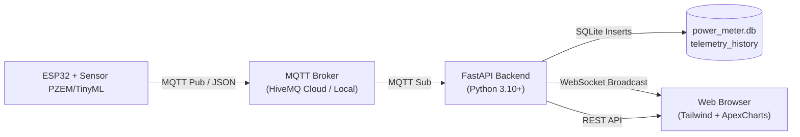

# ⚡ Smart Power Meter IoT — Web Platform

Platform pemantauan telemetri energi listrik cerdas (*Smart Power Meter*) berbasis **FastAPI**, **WebSocket real-time**, dan **MQTT**. Sistem ini dirancang untuk menampilkan parameter metrologi True-RMS dari mikrokontroler ESP32, inferensi prediksi energi TinyML 24 jam ke depan, serta Decision Support System (DSS) untuk pencegahan trip MCB dan optimalisasi kuota listrik prabayar.

---

## 📑 Daftar Isi
- [Fitur Utama](#-fitur-utama)
- [Arsitektur Sistem](#-arsitektur-sistem)
- [Struktur Direktori](#-struktur-direktori)
- [Spesifikasi Tampilan & Antarmuka](#-spesifikasi-tampilan--antarmuka)
- [Dokumentasi API & WebSocket](#-dokumentasi-api--websocket)
- [Konfigurasi Lingkungan (Environment Variables)](#-konfigurasi-lingkungan-environment-variables)
- [Panduan Instalasi & Menjalankan](#-panduan-instalasi--menjalankan)
- [Optimasi Performa](#-optimasi-performa)

---

## 🚀 Fitur Utama

### 1. Dasbor Real-Time (`/`)
- **Metrologi True-RMS**: Tegangan ($V$), Arus ($A$), Daya Aktif ($W$), Daya Semu ($VA$), dan Power Factor ($PF$).
- **Manajemen Kuota Prabayar**: Sisa kuota saldo ($kWh$) dan estimasi sisa waktu pemakaian (*runway hours*).
- **Indikator Beban Kontrak MCB**: Bilah visual kapasitas beban saat ini terhadap kontrak daya (misal $1300\text{ VA}$), dengan sistem pewarnaan dinamis:
  - Biru Modern (`#3B82F6`): Beban aman ($< 70\%$).
  - Amber (`#F59E0B`): Beban siaga ($70\% - 84\%$).
  - Rose (`#EF4444`): Beban kritis ($\ge 85\%$).
- **Visualisasi TinyML 24 Jam**: Grafik batang horizon energi 4 kuadran ($Q1\text{ 0-6j}$, $Q2\text{ 6-12j}$, $Q3\text{ 12-18j}$, $Q4\text{ 18-24j}$) dan perkiraan biaya rupiah berdasarkan tarif per kWh.
- **Decision Support System (DSS)**: Mesin aturan deterministik yang memberikan rekomendasi aksi proteksi beban lebih (*overload*) dan risiko pemadaman dini hari sebelum fajar (*dawn blackout protection*).
- **Grafik Live Watt vs VA**: Grafik area real-time dengan batas anotasi kontrak PLN.
- **Saran AI (LLM)**: Kartu rekomendasi preskriptif berbasis LLM (Gemini / API kompatibel OpenAI). Dipicu otomatis saat status DSS berubah dan tiap 10 menit, atau manual lewat tombol *Minta Saran AI*. Aturan deterministik tetap menjadi penentu status; LLM hanya memberi saran tindakan.

### 2. Riwayat & Analisis Telemetri (`/history`)
- **Filter Fleksibel**: Tombol pintas preset (*Hari Ini*, *7 Hari*, *30 Hari*) dan formulir kustom rentang tanggal.
- **KPI Summary Cards**: Total konsumsi kWh terukur, estimasi tagihan/biaya (Rp), beban semu puncak ($VA$), daya aktif puncak ($W$), dan rata-rata faktor daya ($PF$).
- **4 Grafik Analitik Interaktif**:
  1. *Profil Beban*: Daya Aktif ($W$) vs Daya Semu ($VA$) terhadap batas kontrak.
  2. *Kualitas Listrik*: Dual-axis Tegangan RMS ($V$) & Kuat Arus RMS ($A$).
  3. *Tren Saldo Kuota*: Saldo ($kWh$) & sisa jam pakai (*hours*).
  4. *Histori Proyeksi TinyML*: Tren estimasi kuadran Q1–Q4 dari waktu ke waktu.
- **Log Data & Ekspor CSV**: Tabel telemetri historis dengan tombol unduh file `.csv` untuk audit metrologi data luring.
- **Sinkronisasi Beban di Navbar**: Menampilkan persentase beban aktual secara real-time via WebSocket.

---

## 🏗 Arsitektur Sistem



1. **Ingestion**: ESP32 mengukur parameter kelistrikan, menjalankan model TinyML terkompilasi, dan mengirimkan payload JSON ke topik MQTT broker.
2. **Processing & Storage**: Backend FastAPI berlangganan topik MQTT, melakukan validasi tipe/nilai, mengevaluasi aturan DSS, dan mencatat riwayat ke SQLite (`telemetry_history`).
3. **Distribution**: Data disiarkan seketika (*sub-second*) kepada semua peramban yang terhubung via WebSocket.

---

## 📂 Struktur Direktori

```text
website/
├── recommender_engine.py # Penasihat LLM (Tier 3), tanpa dependensi tambahan
├── main.py              # Server FastAPI, klien MQTT, WebSocket manager, DSS engine, & database handler
├── requirements.txt     # Daftar pustaka dependensi Python
├── power_meter.db       # Database SQLite lokal (dibuat otomatis jika belum ada)
├── README.md            # Dokumentasi platform web
└── templates/
    ├── index.html       # Halaman dasbor telemetri real-time
    └── history.html     # Halaman riwayat telemetri, analitik, dan ekspor CSV
```

---

## 🎨 Spesifikasi Tampilan & Antarmuka

Antarmuka dibangun dengan panduan **Modern Dark Mode** untuk meminimalkan kelelahan mata (*eye strain*) operator:
- **Canvas / Background Utama**: `#121212` (bukan hitam pekat murni `#000000`).
- **Sidebar & Top Header**: `#181818` (elevasi menengah).
- **Cards & Container Permukaan**: `#1E1E1E` (permukaan terangkat).
- **Border & Pembatas**: `#2E2E2E` (halus dan tidak mengaburkan fokus).
- **Hover State**: `#262626`.
- **Teks Utama**: `#E0E0E0` (rasio kontras $\ge 7:1$, nyaman dibaca tanpa silau).
- **Teks Sekunder**: `#9E9E9E` (memenuhi standar WCAG AA $\ge 4.5:1$).
- **Aksen Utama**: `#3B82F6` (*Electric Blue*).
- **Tipografi**: `Inter` sans-serif dengan fitur `tabular-nums` untuk angka metrologi yang stabil.
- **Responsif Mobile**: Drawer samping tersembunyi dengan tombol hamburger di sisi kiri atas dan *overlay backdrop* di atas konten.

---

## 🔌 Dokumentasi API & WebSocket

### 1. Halaman Web (HTML)
| Method | Endpoint | Deskripsi |
| :--- | :--- | :--- |
| `GET` | `/` | Dasbor pemantauan real-time |
| `GET` | `/history` | Halaman riwayat dan audit telemetri |

### 2. WebSocket Real-Time
- **URL**: `ws://<HOST>:<PORT>/ws` (atau `wss://` saat HTTPS aktif).
- **Arah**: Server ke Klien (Siaran otomatis setiap ada paket MQTT baru).
- **Format Payload (JSON)**:
```json
{
  "voltage": 224.5,
  "current": 1.250,
  "power": 265.4,
  "apparent_power": 280.6,
  "pf": 94.6,
  "saldo_kwh": 14.85,
  "runway_hours": 55.9,
  "q1": 0.45,
  "q2": 0.60,
  "q3": 0.82,
  "q4": 0.51,
  "timestamp": "2026-10-10 14:30:00",
  "kontrak_daya_va": 1300,
  "tarif_per_kwh": 1444.7,
  "device_ready": true,
  "age_s": 0.4,
  "dss": {
    "status": "OPTIMAL",
    "badge_color": "emerald",
    "title": "BEBAN DALAM BATAS AMAN",
    "message": "Daya semu berada di bawah ambang batas waspada.",
    "excess_watt": 0.0
  }
}
```

### 3. REST API
#### a. Ambil Data Histori
- **Endpoint**: `GET /api/history`
- **Query Parameters**:
  - `start_date` *(opsional, string YYYY-MM-DD)*: Tanggal awal filter.
  - `end_date` *(opsional, string YYYY-MM-DD)*: Tanggal akhir filter.
  - `limit` *(opsional, integer, default: 500)*: Batas titik sampel grafik untuk downsampling.
- **Contoh Respons**:
```json
{
  "status": "success",
  "summary": {
    "total_records": 1250,
    "total_kwh": 4.82,
    "peak_va": 840.5,
    "peak_watt": 790.0,
    "avg_pf": 93.4,
    "estimated_cost_rp": 6963,
    "kontrak_daya_va": 1300
  },
  "series": [ ... ],
  "table_data": [ ... ]
}
```

#### a2. Saran AI (LLM)
- `GET /api/ai-advisory`: saran terakhir dari cache (tidak memanggil LLM).
- `POST /api/ai-advisory`: permintaan manual; memanggil LLM bila cooldown 15 detik terpenuhi.
- **Respons**: `{"status": "success", "data": {"enabled": true, "model": "...", "advice": {"ringkasan_kondisi", "urgensi", "tindakan_rekomendasi", "dampak_tindakan", "saran_token", "source", "generated_at", "dss_status", "dss_title"}}}`

#### b. Ekspor CSV
- **Endpoint**: `GET /api/history/export`
- **Query Parameters**: `start_date`, `end_date` *(opsional)*.
- **Respons**: Streaming file unduhan `power_meter_YYYYMMDD_HHMMSS.csv`.

---

## ⚙ Konfigurasi Lingkungan (Environment Variables)

Variabel lingkungan dapat didefinisikan langsung pada sistem atau file `.env`:

| Variabel | Tipe | Default | Deskripsi |
| :--- | :--- | :--- | :--- |
| `MQTT_BROKER` | String | `broker.hivemq.com` | Host / alamat broker MQTT |
| `MQTT_PORT` | Integer | `1883` | Port broker MQTT |
| `MQTT_TOPIC` | String | `elevate2026/powermeter/telemetry` | Topik langganan telemetri |
| `KONTRAK_DAYA_VA`| Float | `1300.0` | Batas kapasitas MCB meteran (VA) |
| `TARIF_PER_KWH` | Float | `1444.70` | Tarif listrik PLN golongan R1/1300 (Rp/kWh) |
| `MAX_GAP_SECONDS`| Integer | `300` | Ambang jeda data untuk integrasi trapesium energi |
| `LLM_API_KEY` | String | *(kosong)* | Kunci API LLM (alias `GEMINI_API_KEY`). Kosong = saran berbasis aturan saja |
| `LLM_PROVIDER` | String | `gemini` | `gemini` atau `openai` (API kompatibel OpenAI: Groq, OpenRouter) |
| `LLM_MODEL` | String | `gemini-3.1-flash-lite` | Nama model |
| `LLM_BASE_URL` | String | *(kosong)* | Wajib bila `LLM_PROVIDER=openai`, mis. `https://api.groq.com/openai/v1` |
| `LLM_PERIODIC_S` | Integer | `600` | Refresh berkala saat status tidak berubah |
| `LLM_MIN_INTERVAL_S` | Integer | `30` | Jeda minimum antar panggilan otomatis |

---

## 🛠 Panduan Instalasi & Menjalankan

### 1. Prasyarat
- Python 3.10 atau versi yang lebih baru
- Akses internet untuk CDN Tailwind, Boxicons, dan ApexCharts

### 2. Pemasangan Dependensi
Pastikan berada pada direktori `website/`:
```bash
# Buat dan aktifkan virtual environment (opsional tetapi disarankan)
python3 -m venv .venv
source .venv/bin/activate

# Pasang pustaka dependensi
pip install -r requirements.txt
```

Isi dependensi ([`requirements.txt`](file:///home/ridho/ngoding/IoT%20Prediksi%20kWh/website/requirements.txt)):
- `fastapi`
- `uvicorn`
- `paho-mqtt`
- `websockets`
- `jinja2`

### 3. Menjalankan Server
Jalankan aplikasi menggunakan **Uvicorn**:
```bash
uvicorn main:app --host 0.0.0.0 --port 8000 --reload
```
Aplikasi dapat diakses melalui browser pada:
- **Dasbor Utama**: `http://localhost:8000`
- **Riwayat & Analitik**: `http://localhost:8000/history`
- **Dokumentasi Interaktif Swagger**: `http://localhost:8000/docs`

---

## ⚡ Optimasi Performa

Halaman riwayat dilengkapi serangkaian optimasi rendering untuk menjamin antarmuka tetap berjalan pada 60 FPS tanpa jeda (*zero UI freeze*):
1. **Adaptive Sampling**: Kueri data histori otomatis menerapkan *step-based downsampling* ke batas optimal (150 titik) untuk grafik SVG, memangkas beban kalkulasi kurva Bezier hingga 85%.
2. **Staggered Asynchronous Rendering**: Grafik dirender secara bertahap menggunakan *micro-task queue* agar thread JavaScript browser tidak terblokir.
3. **Single DOM Reflow**: Injeksi 50 baris tabel telemetri menggunakan `DocumentFragment` untuk menghindari *DOM thrashing*.
4. **Database Indexing**: Kolom `timestamp` pada SQLite dipasangi B-Tree index (`idx_telemetry_ts`) sehingga kueri rentang jutaan baris tetap responsif.

